<div align="center">

<picture>
  <source media="(prefers-color-scheme: dark)" srcset="web/public/brand/kuajo-horizontal-negative.svg">
  
</picture>

### Conectamos cada lote con cada decisión

**Transformación Digital Industrial de la línea de yogures de Lácteos Pomar · planta Cajicá**

Proyecto integrador · Automatización de Procesos de Manufactura 2026-2 · Universidad Nacional de Colombia · Equipo 2

[](https://kuajoautomation.github.io/Kuajo-Automation---APM/)
[](informes/Informe_Kuajo_APM_2026-2_Linea1_Yogures.pdf)
[](05_pm4r/Planeacion_PM4R_Kuajo_Pomar.xlsx)
[](https://www.youtube.com/watch?v=E6pVgTWkzJ8)

[](https://github.com/kuajoautomation/Kuajo-Automation---APM/actions/workflows/deploy-pagina.yml)


</div>

> [!NOTE]
> **Caso académico.** Lácteos Pomar es una empresa real usada como referencia de escala y portafolio. Los problemas, indicadores y datos operativos son supuestos del curso.
>
> **Estimaciones preliminares.** Las metas de proceso y las cifras financieras son estimaciones basadas en cálculos preliminares, con datos supuestos del caso académico. Se confirmarán con la medición de la línea base y con cotizaciones. El cálculo completo está en el [informe](informes/Informe_Kuajo_APM_2026-2_Linea1_Yogures.pdf) y en el [libro de planeación](05_pm4r/Planeacion_PM4R_Kuajo_Pomar.xlsx) (anexo A); el [resumen de estimaciones](05_pm4r/Resumen_Estimaciones_Kuajo.xlsx) indica de qué hoja y celda sale cada cifra.

---

## Contenido

1. [Resumen ejecutivo](#resumen-ejecutivo)
2. [Equipo](#equipo)
3. [Cliente y problema](#cliente-y-problema)
4. [Planta y líneas de producción](#planta-y-líneas-de-producción)
5. [Situación actual y VSM](#situación-actual-y-vsm)
6. [Solución propuesta](#solución-propuesta)
7. [Recetas e ISA-88](#recetas-e-isa-88)
8. [Arquitectura ISA-95 y red OT/IT](#arquitectura-isa-95-y-red-otit)
9. [Instrumentación y P&ID](#instrumentación-y-pid)
10. [Simulación](#simulación)
11. [Planeación PM4R](#planeación-pm4r)
12. [Evaluación financiera](#evaluación-financiera)
13. [Oferta comercial y líneas 2 y 3](#oferta-comercial-y-líneas-2-y-3)
14. [Estado por módulo](#estado-por-módulo)
15. [Conclusiones](#conclusiones)
16. [Entregables y enlaces](#entregables-y-enlaces)
17. [Organización del repositorio](#organización-del-repositorio)
18. [Página web: publicación y desarrollo](#página-web-publicación-y-desarrollo)

---

## Resumen ejecutivo

**Kuajo Automation S.A.S.** es un integrador B2B de automatización para la industria láctea. Integramos proceso, PLC, SCADA, MES y ERP bajo **ISA-95** e **ISA-88**.

Lácteos Pomar debe producir **20 % más** en su línea de yogures para cumplir un contrato nuevo, sin construir otra planta. Proponemos automatizar la línea 1 con:

- recetas ISA-88,
- un MES integrado con SAP,
- inspección automática,
- una celda robotizada de fin de línea,
- y comisionamiento virtual con gemelo digital.

Con esto, estimamos que la línea pasaría de **43.700 a ≈ 52.400 kg/día** sin comprar equipos de proceso nuevos.

<div align="center">

| | Hoy | Meta estimada |
|:--|:--:|:--:|
| **OEE de la llenadora de vasos** | 55,4 % | **≈ 78 %** |
| **Producción de la línea (kg/día)** | 43.700 | **≈ 52.400** |
| **Cumplimiento de la demanda** | 83,4 % | **≈ 100 %** |
| **Trazabilidad de un lote (recall)** | 6 h | **< 30 min** |
| **Cambio de receta Y2 → Y1** | 90 min | **≈ 35 min** |
| **Rechazo por peso o sellado** | 3 % | **≈ 1 %** |
| **Operarios de fin de línea por día** | 8 | **2** |
| **Rezago de los KPIs** | 7 días | **En línea** |

| Precio Fase 1 | VPN (TIO 13,7 %) | TIR | Recuperación | Beneficio/costo |
|:--:|:--:|:--:|:--:|:--:|
| **≈ $8.500 M** · ≈ US$2,6 M | **≈ $15.000 M** | **≈ 49 %** | **≈ 2,2 años** | **≈ 2,6** |

<sub>Cifras preliminares redondeadas. ¿De dónde sale cada una? → [Resumen de estimaciones (Excel)](05_pm4r/Resumen_Estimaciones_Kuajo.xlsx)</sub>

</div>

---

## Equipo

Cada módulo tiene dos responsables que se revisan entre sí (ver [Estado por módulo](#estado-por-módulo)).

<table align="center">
  <tr>
    <td align="center" width="33%">
      <br>
      <b>Duvan Felipe Pacheco Rodriguez</b><br>
      <sub><code>R1</code> Gerente de proyecto</sub><br>
      <sub>PM4R, EDT, cronograma, curva S, riesgos y bitácora</sub><br>
      <a href="mailto:dupachecor@unal.edu.co">dupachecor@unal.edu.co</a>
    </td>
    <td align="center" width="33%">
      <br>
      <b>Paula Valentina Alvarez Chaparro</b><br>
      <sub><code>R2</code> Arquitecta TDI (OT/IT)</sub><br>
      <sub>ISA-95, ISA-88, MES y ERP</sub><br>
      <a href="mailto:palvarezch@unal.edu.co">palvarezch@unal.edu.co</a>
    </td>
    <td align="center" width="33%">
      <br>
      <b>David Felipe Garcia Lopez</b><br>
      <sub><code>R3</code> Ingeniero de procesos</sub><br>
      <sub>Caracterización, 9 recetas, balance de masa y diagramas</sub><br>
      <a href="mailto:dagarcialo@unal.edu.co">dagarcialo@unal.edu.co</a>
    </td>
  </tr>
  <tr>
    <td align="center">
      <br>
      <b>Juan Angel Vargas Rodriguez</b><br>
      <sub><code>R4</code> Ingeniero de producción</sub><br>
      <sub>VSM, KPIs base, simulación y Tecnomatix</sub><br>
      <a href="mailto:juvargasro@unal.edu.co">juvargasro@unal.edu.co</a>
    </td>
    <td align="center">
      <br>
      <b>Jose Luis Pulido Fonseca</b><br>
      <sub><code>R5</code> Ingeniero de control y robótica</sub><br>
      <sub>P&amp;ID, instrumentación, PLC y RobotStudio</sub><br>
      <a href="mailto:jpulidof@unal.edu.co">jpulidof@unal.edu.co</a>
    </td>
    <td align="center">
      <br>
      <b>Ian Saonni Rodriguez Pulido</b><br>
      <sub><code>R6</code> Ingeniero de supervisión y comunicaciones</sub><br>
      <sub>SCADA Ignition, gemelo digital, GitHub, web y video</sub><br>
      <a href="mailto:irodriguezpu@unal.edu.co">irodriguezpu@unal.edu.co</a>
    </td>
  </tr>
</table>

**Forma de trabajo:**
- **Reuniones:** una reunión semanal por Google Meet. No llevamos actas: en cada reunión quedan tareas para la semana, con fecha de entrega.
- **Documento compartido:** durante la preparación trabajamos en un Google Docs compartido, al que todos teníamos acceso y que editábamos al mismo tiempo.
- **Repositorio:** al terminar esta etapa creamos este repositorio en GitHub para reunir los documentos finales.
- **Siguiente etapa:** usaremos GitHub para organizar y compartir los desarrollos de simulación, control, SCADA y gemelo digital.

---

## Cliente y problema

**Lácteos Pomar**, planta Cajicá (Cundinamarca). Acopia ≈ 260.000 L de leche al día y trabaja 2 turnos de 8 h, 6 días por semana.

Lácteos Pomar necesita aumentar su producción un 20 % y lanzar nuevas referencias sin construir una planta nueva. Hoy no lo logra porque:

- tiene islas de automatización,
- lleva sus registros en papel,
- y no tiene visibilidad en tiempo real.

| | Problema | Evidencia | Se resuelve con |
|:--:|:--|:--|:--|
| P1 | Capacidad insuficiente | Llenadora de vasos al 100 % de ocupación, OEE 55,4 % | VSM · simulación |
| P2 | Cambios de receta lentos | Setup de 90 min con CIP manual | ISA-88 · PLC |
| P3 | Trazabilidad en papel | Rastrear un lote toma ≈ 6 h | MES · ISA-95 |
| P4 | Variabilidad de calidad | 3 % de rechazo; fermentaciones fuera de pH | Control · inspección |
| P5 | Datos aislados | KPIs en Excel, una vez por semana | SCADA · MES · Power BI |
| P6 | Riesgo ergonómico | Paletizado manual de cajas de 12 a 18 kg | Celda robotizada |
| P7 | Consumos no medidos | Sin submedición de vapor, agua ni energía | SCADA · KPIs |

---

## Planta y líneas de producción

La planta tiene tres líneas con tres referencias cada una (9 recetas). Este proyecto estudia en detalle la **línea 1 (yogures)**; las líneas 2 y 3 se dimensionan en el anexo C.

| Línea | Referencias | Leche asignada | Lote |
|:--|:--|:--:|:--|
| **L1 Yogures** | Y1 batido de fresa (vaso 150 g) · Y2 griego alto en proteína (vaso 500 g) · Y3 kéfir (botella 1 L) | 70.000 L/día | Fermentador de 10.000 L |
| L2 Quesos | Q1 campesino · Q2 doble crema · Q3 cuajada | 60.000 L/día | Tina de 10.000 L |
| L3 UHT y bebidas | U1 entera · U2 deslactosada · U3 achocolatada | 90.000 L/día | Tanque de 15.000 L |

<details>
<summary><b>Ver diagrama de bloques y distribución de planta</b></summary>

<p align="center"></p>
<p align="center"><sub>Figura 5.1 · Diagrama de bloques de la planta</sub></p>

<p align="center">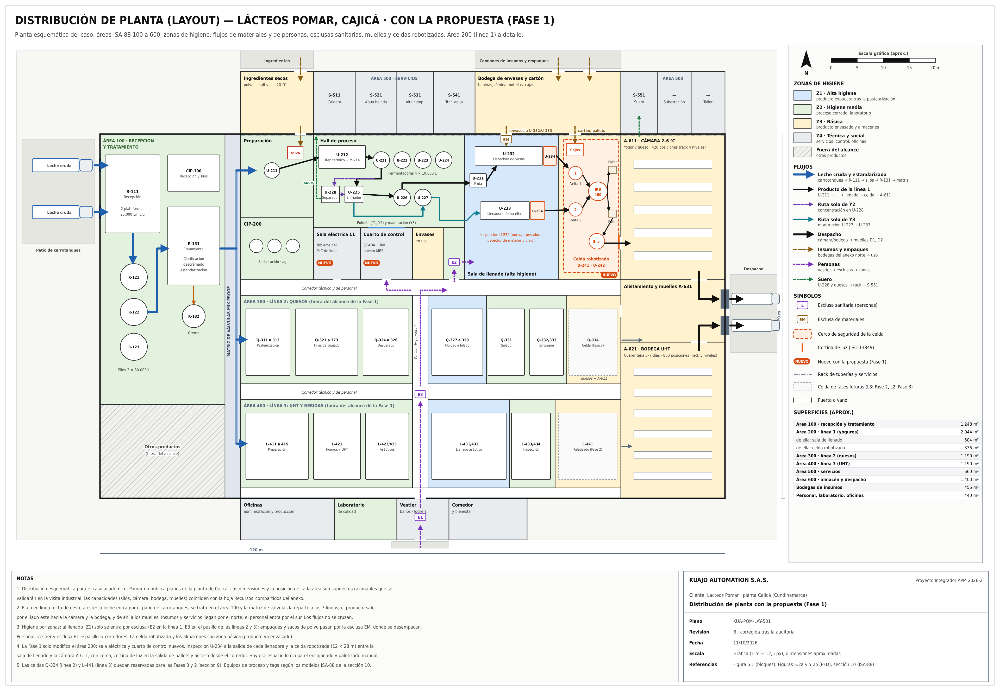</p>
<p align="center"><sub>Figura 5.5 · Distribución de planta</sub></p>

</details>

---

## Situación actual y VSM

Hoy la **llenadora de vasos es el cuello de botella**: necesita 14,0 de las 14 h disponibles, aunque a velocidad nominal le bastarían 7,8 h. La línea trabaja a 1,15 s/kg cuando el takt time es de 0,96 s/kg, es decir, 20 % por debajo de lo que pide el cliente.

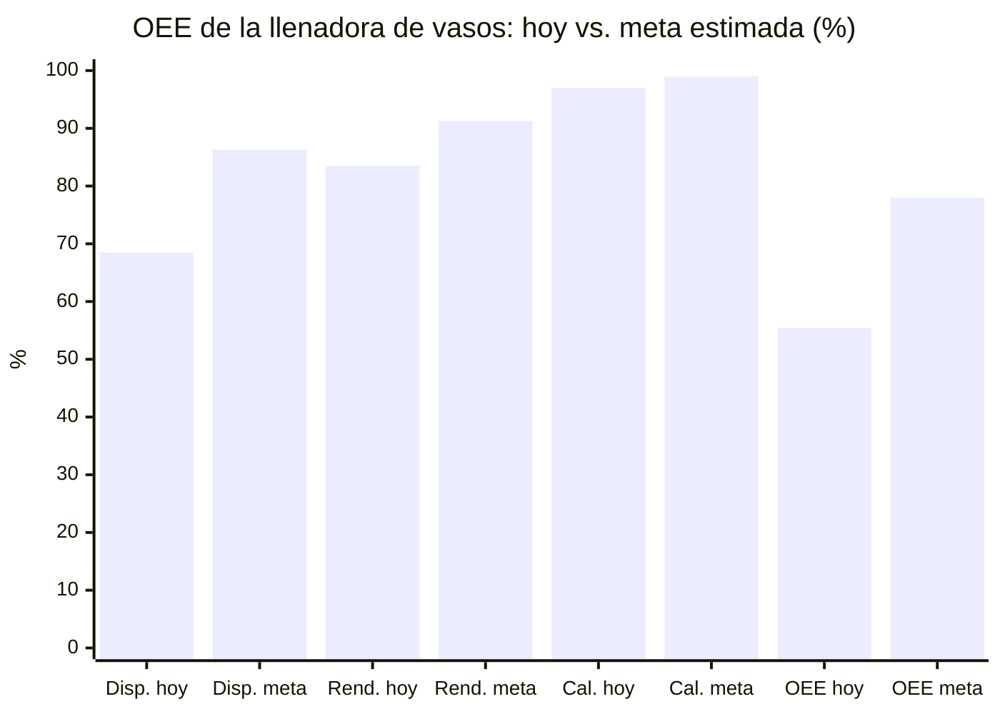

<sub>OEE = disponibilidad × rendimiento × calidad. Meta estimada: ≈ 86 % × 91 % × 99 % ≈ 78 %.</sub>

**¿Cómo sabemos que la meta es alcanzable?**
- El OEE se descompone pérdida por pérdida: disponibilidad ≈ 86 %, rendimiento ≈ 91 % y calidad ≈ 99 %, cada una ligada a una mejora concreta.
- Para cumplir el +20 % basta un OEE de **≈ 70 %** (9,72 de las 14 h disponibles), así que la meta de ≈ 78 % deja margen.
- La simulación preliminar da un resultado parecido. El primer paso del proyecto es medir la línea base para confirmarlo.

Las ocho mejoras kaizen del VSM futuro y su efecto estimado:

| | Mejora | Efecto estimado |
|:--:|:--|:--|
| K1 | Recetas ISA-88 y CIP automático | Cambio de receta de 90 a ≈ 35 min |
| K2 | pH en línea y fin de fase automático | ≈ −1,25 h por lote |
| K3 | Pesadora, detector de metales y visión | Rechazo de 3 a ≈ 1 % |
| K4 | Carril FIFO secuenciado por el MES | Espera en el pulmón de 4 a ≈ 1,5 h |
| K5 | Celda robotizada | De 4 a 1 operario por turno |
| K6 | Plan diario de SAP al MES | Inventario de 48 a ≈ 24 h |
| K7 | Genealogía del lote (Track & Trace) | Trazabilidad de 6 h a < 30 min |
| K8 | Submedición de energía, vapor y agua | Consumos por lote; ahorro de ≈ 3 % |

**MLT de un lote de Y1:** de 4,2 a ≈ 3 días. **Tiempo que agrega valor:** de 11,4 % a ≈ 15 %.

<details>
<summary><b>Ver VSM actual y futuro</b></summary>

<p align="center">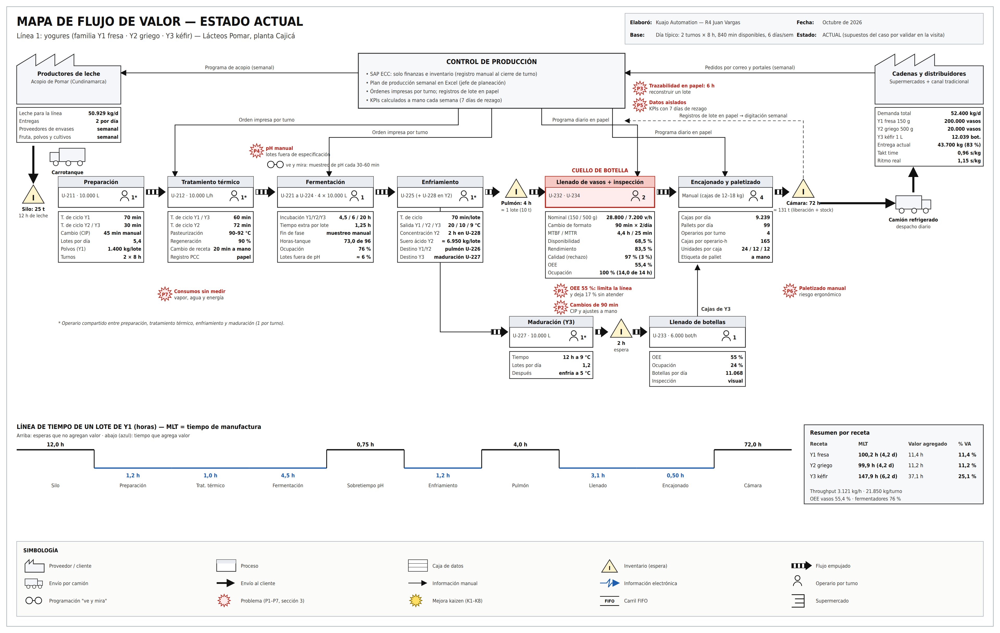</p>
<p align="center"><sub>VSM actual · línea de yogures</sub></p>

<p align="center"></p>
<p align="center"><sub>VSM futuro · heijunka en los fermentadores y FIFO aguas abajo</sub></p>

</details>

---

## Solución propuesta

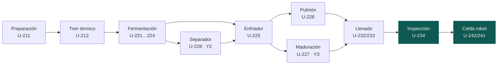

La propuesta conserva los equipos de proceso de Pomar y añade:

- PLC de línea ControlLogix con fases ISA-88,
- SCADA Ignition,
- MES Sepasoft integrado con SAP,
- pH en línea,
- inspección automática (pesadora, detector de metales y visión),
- una celda robotizada con 2 robots delta y un paletizador.

Con la propuesta, la restricción pasa de la llenadora a la **fermentación**, que depende de la biología del cultivo.

<details>
<summary><b>Ver PFD actual y propuesto</b></summary>

<p align="center">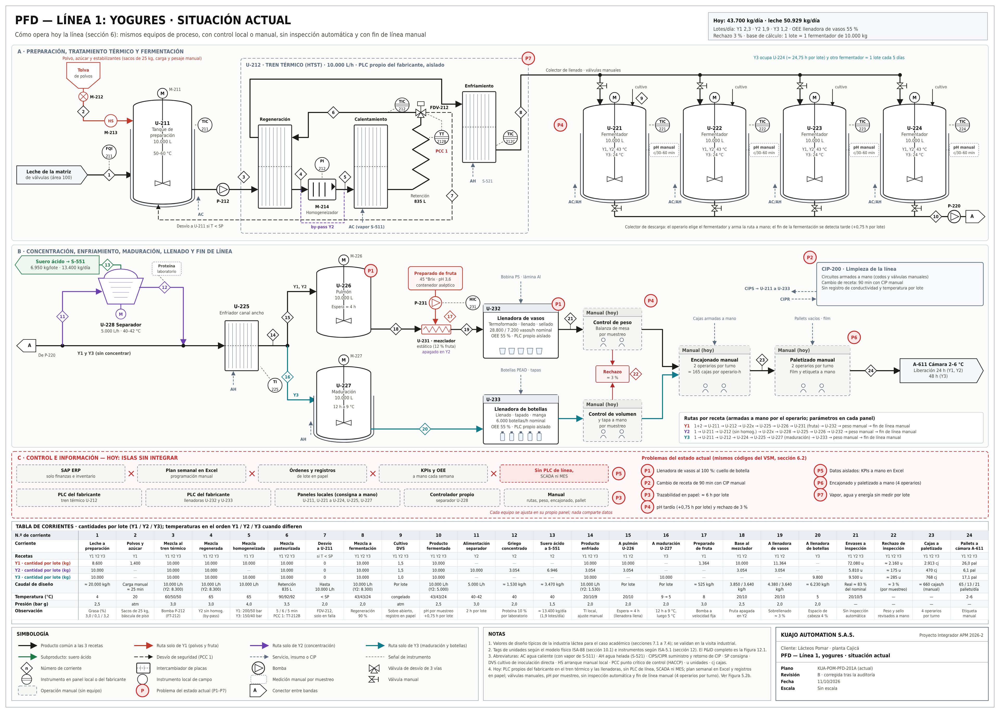</p>
<p align="center"><sub>Figura 5.2a · PFD actual de la línea 1</sub></p>

<p align="center">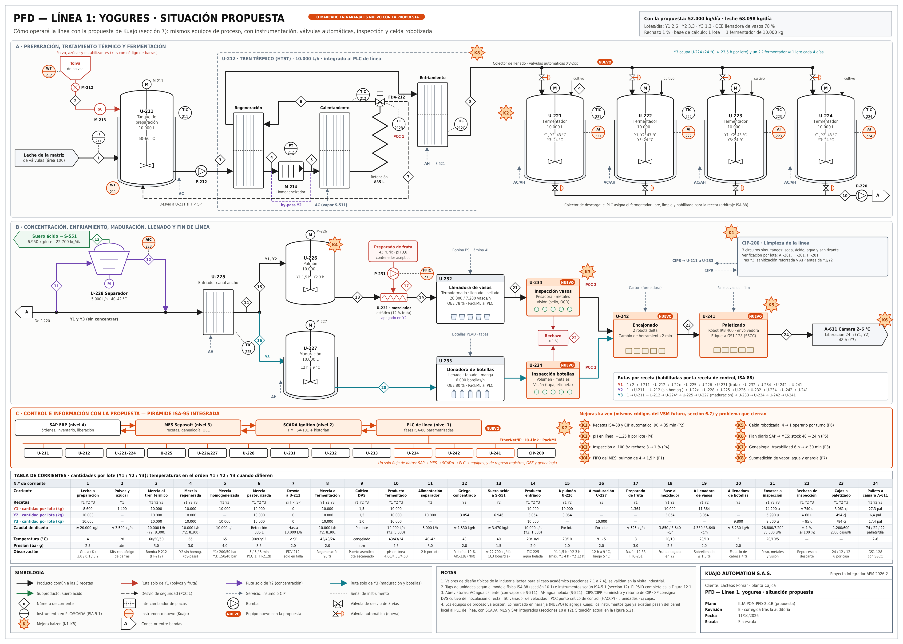</p>
<p align="center"><sub>Figura 5.2b · PFD propuesto de la línea 1</sub></p>

</details>

---

## Recetas e ISA-88

Un solo procedimiento ISA-88, con sus parámetros, produce las tres recetas. El PLC cambia consignas, rutas y formato automáticamente.

| Parámetro | Y1 Fresa | Y2 Griego | Y3 Kéfir |
|:--|:--:|:--:|:--:|
| Pasteurización | 90 °C · 5 min | 92 °C · 6 min | 92 °C · 5 min |
| Incubación | 43 °C ± 0,5 | 43 °C ± 0,5 | 24 °C ± 0,5 |
| pH de fin de fermentación | 4,60 | 4,50 | 4,50 |
| Tiempo esperado · alarma | 4,5 h · 6 h | 6 h · 7,5 h | 20 h · 24 h |
| Fase propia | Fruta 12 % en línea | Separador a 10 % de proteína | Maduración 12 h a 9 °C |
| Llenado nominal → objetivo | 150 → 152 g | 500 → 505 g | 1.000 → 1.008 mL |
| Vida útil (2–6 °C) | 35 días | 35 días | 21 días |

**Modelo procedimental:** 8 procedimientos de unidad (PU1 preparar … PU8 limpiar). **Modelo físico:** 13 unidades del área 200. **Recetas:** general → de sitio → maestra → de control (una por lote, por ejemplo `Y1-261005-T1-03`).

<p align="center">
  
  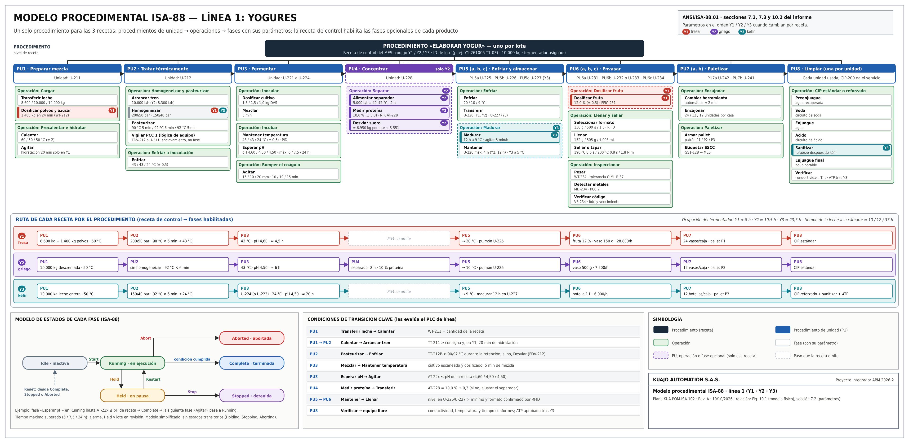
</p>
<p align="center"><sub>Figuras 10.1 y 10.2 · Modelos físico y procedimental ISA-88 · <a href="01_proceso/Fig_7.1_Rutas_recetas.png">rutas de las recetas (Fig. 7.1)</a></sub></p>

---

## Arquitectura ISA-95 y red OT/IT

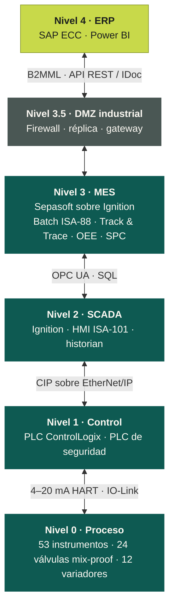

La DMZ industrial es el único paso entre OT e IT, según la norma ISA/IEC 62443. Las llenadoras OEM y los robots se conectan al PLC por EtherNet/IP con PackML.

<p align="center">
  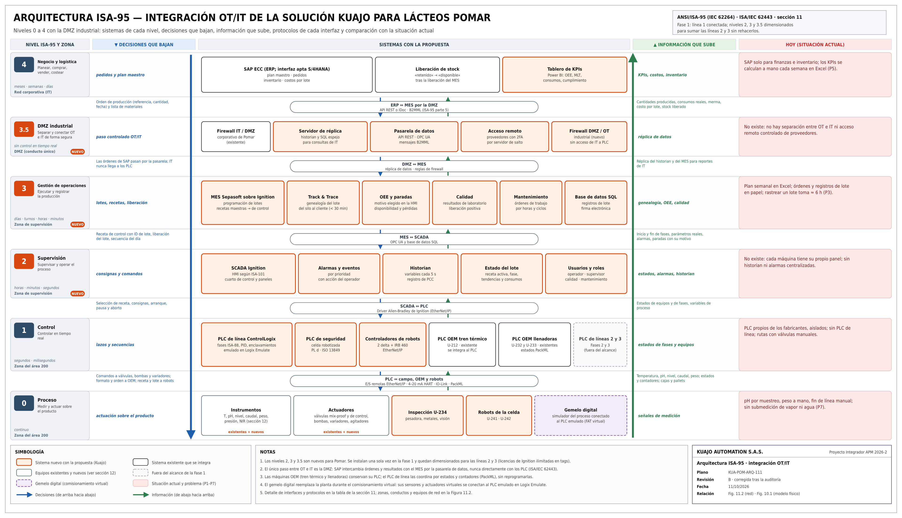
  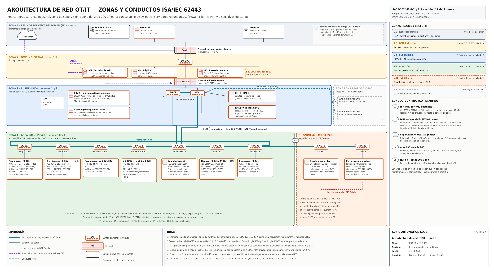
</p>
<p align="center"><sub>Figuras 11.1 y 11.2 · Arquitectura ISA-95 y red OT/IT</sub></p>

---

## Instrumentación y P&ID

La lista única tiene **86 tags**, según ISA-5.1. Los lazos de control principales son:

| Lazo | Mide | Actúa sobre | Objetivo |
|:--|:--|:--|:--|
| TIC-212 | TT-212A | TCV-212 | Pasteurización a 90 o 92 °C |
| FIC-212 | FT-212 | SC-212 | Retención de 5 o 6 min |
| TIC-221…224 | TT-221…224 | TCV-22xA/B (rango dividido) | Incubación ± 0,5 °C |
| AI-221…224 | AT-221…224 | — | Fin de la fase «Esperar pH» |
| AIC-228 | AT-228 (NIR) | Separador M-228 | Proteína del griego 10,0 % ± 0,3 |
| FFIC-231 | FT-231 | SC-231 | Razón fruta : base 12 : 88 |

El desvío por temperatura del **PCC 1** no es una fase de la receta. Es un enclavamiento cableado (TSL-212B con FDV-212) que actúa aunque falle el PLC.

<p align="center">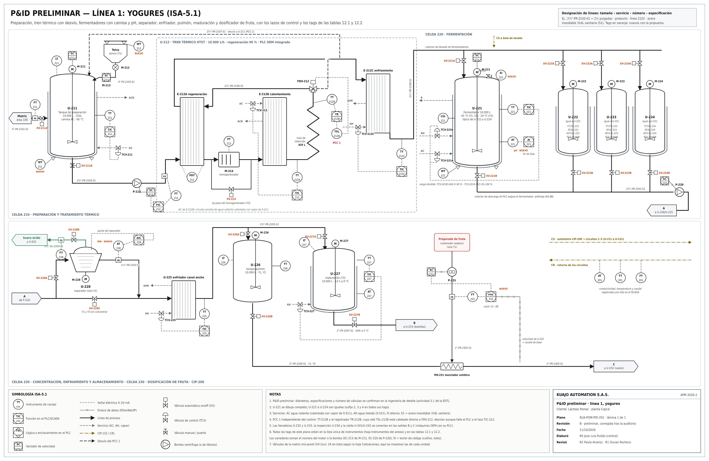</p>
<p align="center"><sub>Figura 12.1 · P&amp;ID preliminar de la línea 1</sub></p>

---

## Simulación

El simulador es propio: modela eventos discretos en Python con paso de 1 min ([`sim.py`](04_produccion/simulacion/sim.py), anexo D). Corre 10 réplicas de 13 semanas y genera fallas exponenciales con el MTBF y el MTTR de cada equipo.

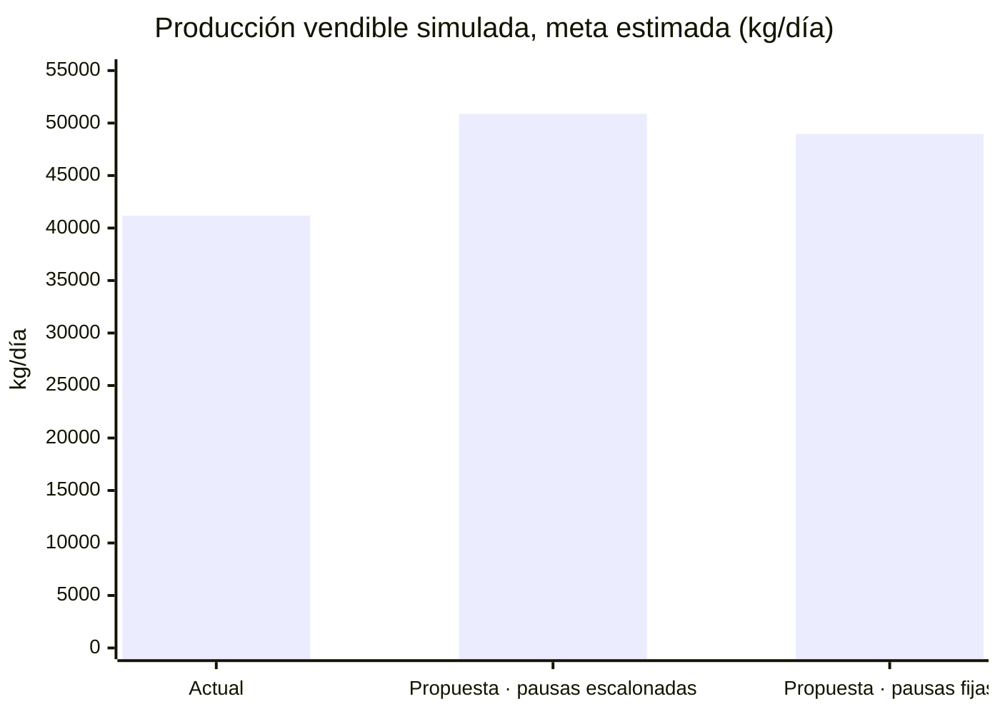

| Escenario | Vendible (kg/día) | Lectura |
|:--|:--:|:--|
| Actual | 41.200 ± 202 | Calibra el modelo: 43.300 kg/día simulados frente a 43.700 del cálculo |
| Propuesta con pausas escalonadas | **50.900 ± 39** | **≈ +24 %** frente a hoy; el atraso no crece |
| Propuesta con pausas fijas | 49.000 ± 210 | El atraso crece hasta 21 lotes en 13 semanas |

La simulación preliminar, con datos supuestos, respalda el aumento. Los fermentadores quedan casi saturados (98 %): por eso el plan solo se cumple con pausas escalonadas y con la secuencia que programa el MES. El modelo en Tecnomatix Plant Simulation está en curso con los mismos datos.

---

## Planeación PM4R

El proyecto se planeó con la metodología **PM4R del BID**. La planeación completa está en el [libro de Excel](05_pm4r/Planeacion_PM4R_Kuajo_Pomar.xlsx) (anexo A), que tiene 23 hojas con fórmulas vivas. Incluye:

- EDT de 38 paquetes,
- CPM con ruta crítica,
- recursos nivelados,
- curva S,
- presupuesto de 66 partidas (el 73 % de los suministros todavía son estimaciones por cotizar),
- riesgos, adquisiciones, comunicaciones y RACI.

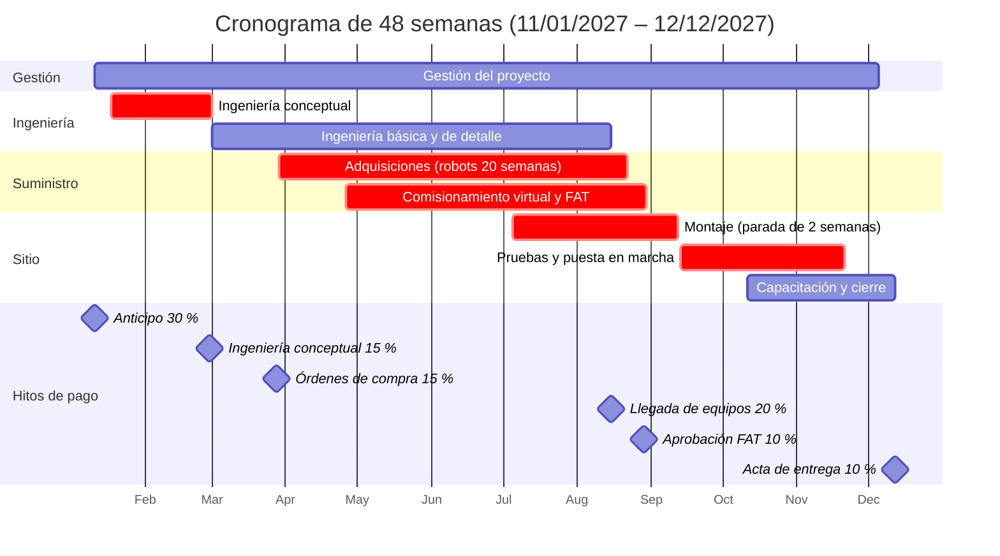

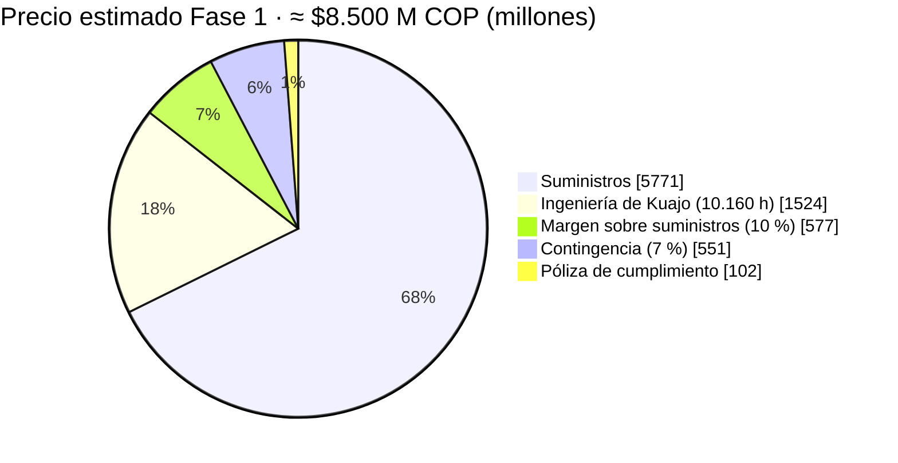

<p align="center">
  
</p>
<p align="center">
  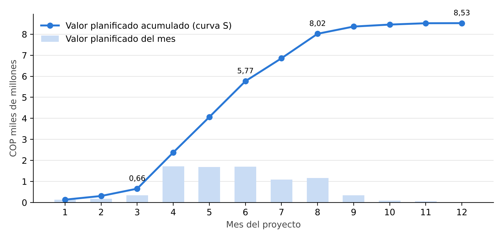
  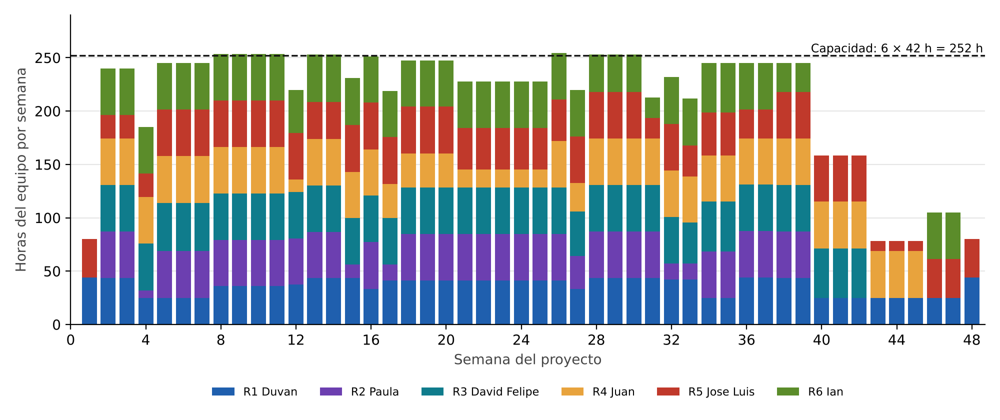
</p>
<p align="center"><sub>Gantt nivelado, curva S e histograma de horas del equipo (pico de 254 h/semana)</sub></p>

---

## Evaluación financiera

La evaluación toma el punto de vista de Pomar, con un horizonte de 7 años sin valor residual y una TIO de 13,7 %.

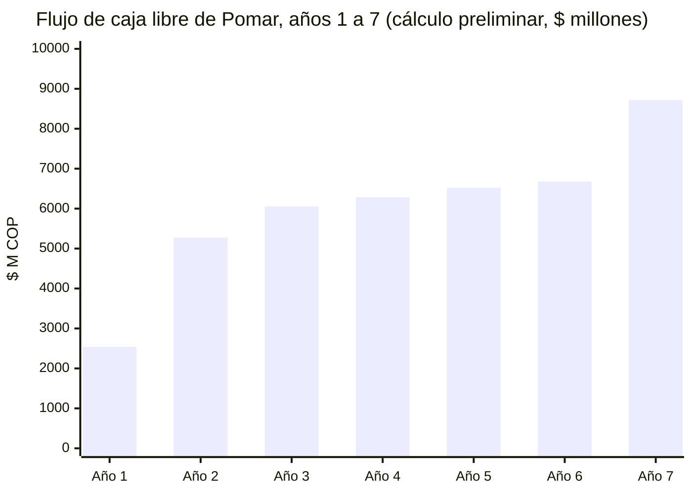

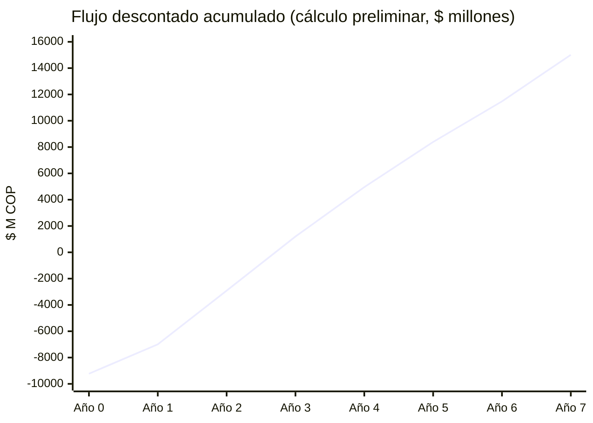

<sub>Año 0: inversión neta de ≈ −$9.200 M. El acumulado descontado se vuelve positivo en el año 3 y cierra en un VPN de ≈ $15.000 M.</sub>

| Indicador | Valor | Nota |
|:--|:--:|:--|
| Inversión de Pomar en el año 0 | ≈ $9.600 M | Precio + parada de 12 días + costo interno |
| Beneficios anuales en régimen | ≈ $8.500 M | |
| OPEX anual | ≈ $590 M | Soporte, mantenimiento, repuestos y energía |
| **VPN** | **≈ $15.000 M** | |
| **TIR** | **≈ 49 %** | ≈ 3,6 veces la TIO |
| Recuperación simple · descontada | ≈ 2,2 · ≈ 2,7 años | |
| Relación beneficio/costo | ≈ 2,6 | |
| Punto de equilibrio | ≈ 40 % | de los beneficios estimados mantiene el VPN ≥ 0 |
| Utilidad neta de Kuajo | ≈ $935 M | ≈ 11 % del contrato |
| Crédito rotativo máximo de Kuajo | ≈ $1.300 M | Mes 8; cupo de $1.500 M |
| Cobertura de la contingencia | ≈ 1,2 | La contingencia cubre ≈ 1,2 veces el riesgo retenido |

**Por qué un crédito rotativo.** El proyecto es rentable, pero cada hito se cobra a 30 días y los robots, los tableros y el montaje se pagan antes, sobre todo en el mes 8. Por eso Kuajo usa un cupo rotativo: saca solo lo que falta, por el tiempo que falta, y paga intereses solo sobre lo usado (≈ $20 M, ya descontados). Un crédito normal desembolsaría todo desde el primer día.

¿De dónde salen estas cifras? → [Resumen de estimaciones (Excel)](05_pm4r/Resumen_Estimaciones_Kuajo.xlsx)

<p align="center"></p>

---

## Oferta comercial y líneas 2 y 3

**Oferta `KA-OF-2026-001`** (precio estimado): diseño, suministro, comisionamiento virtual, montaje y puesta en marcha de la línea de yogures, más la plataforma de planta (SCADA, MES e integración con SAP) sobre la que luego se conectan quesos y UHT. Las condiciones son:

- montaje en una parada máxima de 2 semanas,
- 6 semanas de estabilización,
- garantía de 1 año,
- validez de 90 días.

| Fase | Precio | Semanas | VPN | TIR |
|:--|:--:|:--:|:--:|:--:|
| **Fase 1:** plataforma + yogures | ≈ $8.500 M | 48 | ≈ $15.000 M | ≈ 49 % |
| **Fase 2:** línea UHT (referencia preliminar ±30 %) | ≈ $3.150 M | 26 | ≈ $6.400 M | ≈ 57 % |
| **Fase 3:** línea de quesos (referencia preliminar ±30 %) | ≈ $3.850 M | 32 | ≈ $170 M | ≈ 15 % |
| **Planta completa** (referencia preliminar ±30 %) | **≈ $15.500 M** | **106** | **≈ $20.800 M** (combinado) | |

Se recomienda empezar por UHT, la de mejor retorno. Con las tres fases, la planta pasaría de 133.377 a ≈ 151.120 kg/día (+13 %). El detalle de las líneas 2 y 3 está en el [anexo C](informes/Anexo_C_Lineas_2_y_3.docx).

---

## Estado por módulo

Todo el equipo trabajó en esta entrega. Cada módulo tiene dos responsables que se revisan entre sí.

| Módulo | Evidencia | Responsables | Estado |
|:--|:--|:--|:--:|
| Transformación Digital Industrial | ISA-95, red OT/IT, ISA-88 físico y procedimental, P&ID | Paula · Jose Luis | Entregado |
| Gestión de la producción | VSM actual y futuro, KPIs, simulación en Python | Juan · David | Entregado |
| Planeación de proyectos | EDT, cronograma, presupuesto, flujos, oferta | Duvan · Ian | Entregado |
| Simulación en Tecnomatix | Mismos objetos y datos del modelo en Python | Juan · David | En curso |
| Controladores industriales | Grafcet y Ladder en Logix Emulate con recetas | Jose Luis · David | Entrega final |
| SCADA | Ignition con HMI ISA-101 y OPC | Ian · Paula | Entrega final |
| Digital Factory | Gemelo digital de la línea 1 con Logix Emulate | Ian · Juan | Entrega final |
| Celda robotizada | Diseño, simulación en RobotStudio y riesgos | Jose Luis · Duvan | Entrega final |

---

## Conclusiones

1. Estimamos que la línea de yogures puede producir **20 % más sin comprar equipos de proceso**, subiendo el OEE de 55 % a cerca de 78 %.
2. La simulación preliminar lo respalda y dice qué cuidar en la operación: escalonar las pausas y secuenciar con el MES, porque la fermentación pasa a ser la restricción.
3. Un solo procedimiento ISA-88 produce las tres recetas, y el MES integrado con SAP bajaría la trazabilidad de 6 h a menos de 30 min.
4. Con cálculos preliminares, el proyecto valdría para Pomar unos **$15.000 M** en valor presente (inversión ≈ $9.600 M) y resiste escenarios adversos.
5. Para Kuajo es un buen contrato (≈ 11 % neto), con un riesgo de caja que se financia con un crédito rotativo, y deja la planta lista para seguir con UHT y quesos.

**Próximos pasos:**
- medir la línea base para confirmar estas estimaciones,
- terminar el modelo en Tecnomatix,
- reemplazar estimaciones por cotizaciones,
- preparar la Fase 2.

---

## Entregables y enlaces

| Entregable | Archivo | Descripción |
|:--|:--|:--|
| **Página web** | [kuajoautomation.github.io/Kuajo-Automation---APM](https://kuajoautomation.github.io/Kuajo-Automation---APM/) | Todo el proyecto en una sola página, con las cifras del Excel |
| **Informe de avance** | [PDF](informes/Informe_Kuajo_APM_2026-2_Linea1_Yogures.pdf) · [Word](informes/Informe_Kuajo_APM_2026-2_Linea1_Yogures.docx) | 112 páginas · versión B (11/10/2026) |
| **Resumen de estimaciones** | [Excel](05_pm4r/Resumen_Estimaciones_Kuajo.xlsx) | 5 hojas: cifras clave, supuestos y la hoja y celda del libro completo de donde sale cada una |
| **Anexo A · Planeación PM4R** | [Excel](05_pm4r/Planeacion_PM4R_Kuajo_Pomar.xlsx) | 23 hojas con fórmulas vivas |
| **Anexo B · Figuras en A3** | [PDF](informes/Anexo_B_Figuras_A3.pdf) | 12 figuras técnicas vectoriales |
| **Anexo C · Líneas 2 y 3** | [Word](informes/Anexo_C_Lineas_2_y_3.docx) | Quesos y UHT: recetas, parámetros y KPIs |
| **Anexo D · Simulador** | [`sim.py`](04_produccion/simulacion/sim.py) | Eventos discretos, sin librerías externas |
| **Presentación** | [`Presentacion/`](Presentacion) | Exportación HTML de la sustentación y [`guion.pdf`](Presentacion/guion.pdf) |
| **Video** | [YouTube](https://www.youtube.com/watch?v=E6pVgTWkzJ8) | Sustentación con los 6 integrantes |
| **Intro y outro del video** | [Intro](Presentacion/Kuajo_Intro.mp4) · [Outro](Presentacion/Kuajo_Outro.mp4) | Animaciones de Kuajo, con y sin audio |
| **Enunciado del curso** | [Proyecto integrador](00_curso/3.%20APM%20Proyecto%20Integrador%202026-2.pdf) · [Programa](00_curso/1.APM%20Programa%202026-2.pdf) · [Guía PM4R](00_curso/Gu%C3%ADa%20Metodolog%C3%ADa%20PM4R.pdf) | |

---

## Organización del repositorio

Hay una carpeta por módulo, como indica el informe (sección 15.1). Cada integrante sube su trabajo con commits propios en la carpeta de su módulo.

```text
Kuajo-Automation---APM/
├── 00_curso/        Programa, enunciado del proyecto y guía PM4R del BID
├── 01_proceso/      Bloques, PFD, distribución, rutas de recetas y P&ID (SVG · PDF · PNG)
├── 02_isa88/        Modelos físico y procedimental
├── 03_isa95/        Arquitectura ISA-95 y red OT/IT
├── 04_produccion/   VSM actual y futuro · simulacion/sim.py
├── 05_pm4r/         Libro PM4R (Excel) y gráficas de Gantt, histograma, curva S y flujo
├── informes/        Informe (Word y PDF) y anexos B y C
├── gestion/         Prompts de trabajo y fotos del equipo (equipo/fotos/)
├── Presentacion/    Sustentación (HTML), guion, intro y outro del video
└── web/             Página web del proyecto (Astro)
```

| Carpeta | Responsable |
|:--|:--|
| [`01_proceso/`](01_proceso) | R3 David Felipe · R5 Jose Luis |
| [`02_isa88/`](02_isa88) | R2 Paula |
| [`03_isa95/`](03_isa95) | R2 Paula · R6 Ian |
| [`04_produccion/`](04_produccion) | R4 Juan |
| [`05_pm4r/`](05_pm4r) | R1 Duvan |
| [`informes/`](informes) | Todos |
| [`gestion/`](gestion) · [`gestion/equipo/fotos/`](gestion/equipo/fotos) | R1 Duvan |
| [`Presentacion/`](Presentacion) | R1 Duvan · R6 Ian (video) |
| [`web/`](web) | R6 Ian |

---

## Página web: publicación y desarrollo

La página vive en [`web/`](web) y **no tiene copias propias** del informe, el Excel ni las figuras: al compilar, las toma de las carpetas de módulos. Así, basta con actualizar un archivo en su carpeta para que la página lo publique.

**Publicación.** Cada `push` a `main` ejecuta el flujo [«Publicar la página en GitHub Pages»](.github/workflows/deploy-pagina.yml), que compila y publica la página en 2 a 3 minutos:

```bash
git add .
git commit -m "Actualiza el Excel de planeación"
git push
```

Las cifras escritas en la página se muestran redondeadas como estimaciones preliminares; `npm run check` sigue comparando los valores exactos de `site.ts` con el Excel. Antes de publicar, el flujo verifica que coincidan. Si cambia una cifra que la página muestra escrita (precio, VPN, TIR…), la publicación se detiene y el error indica qué valor hay que actualizar en `web/src/data/site.ts`.

**Clonar con SSH.** Cada integrante registra su llave pública en GitHub (**Settings → SSH and GPG keys**) y luego clona el repositorio:

```bash
git clone git@github.com:kuajoautomation/Kuajo-Automation---APM.git
```

**Desarrollo local.** Requiere Node.js 22.6 o superior:

```bash
cd web
npm install
npm run dev
```

---

<div align="center">
<sub><b>Kuajo Automation S.A.S.</b> · Conectamos cada lote con cada decisión<br>
Universidad Nacional de Colombia · Automatización de Procesos de Manufactura 2026-2</sub>
</div>
