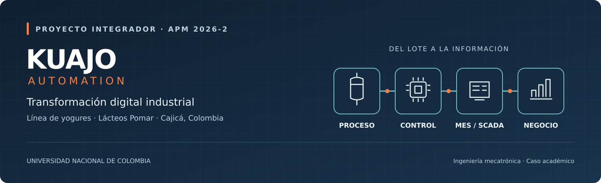

<div align="center">



# Kuajo Automation

**Ingeniería de procesos, automatización e integración OT/IT para la industria láctea.**

Proyecto Integrador APM · 2026-2 · Ingeniería Mecatrónica<br>
Universidad Nacional de Colombia

[Síntesis técnica](documentacion/SINTESIS_PROYECTO.md) · [Galería de figuras](documentacion/CATALOGO_FIGURAS.md) · [Informe completo](documentacion/anexos/Informe_Kuajo_APM_2026-2_Linea1_Yogures.pdf) · [Simulación](simulacion/README.md)

</div>

Kuajo Automation propone transformar la **línea 1 de yogures de Lácteos Pomar, en Cajicá**, mediante control de recetas, instrumentación, inspección y robótica, conectados con una plataforma SCADA/MES y el ERP. La propuesta aprovecha los equipos de proceso existentes y busca aumentar la producción, reducir pérdidas y reconstruir la historia de cada lote desde la materia prima hasta el cliente.

Este repositorio reúne el diseño técnico, la planeación, la evaluación económica y un simulador reproducible de la línea.

> **Contexto académico.** Pomar es una empresa real utilizada como referencia. Los datos operativos, planos, problemas y metas de este caso son supuestos del proyecto. El contenido corresponde al informe versión B del **11 de octubre de 2026** y sus anexos.

| Alcance principal | Meta de capacidad del caso | Propuesta simulada | Implementación prevista |
|---|---|---|---|
| Línea 1 · tres recetas de yogur | 43.700 → 52.400 kg/día | 50.874 kg/día vendibles | 48 semanas · 2027 |

<a id="contenido"></a>
## Contenido

[01 · Problema y objetivos](#problema) · [02 · Proceso y productos](#proceso) · [03 · Automatización](#automatizacion) · [04 · Resultados](#resultados) · [05 · Planeación y economía](#planeacion) · [06 · Expansión](#expansion) · [07 · Documentación](#documentacion) · [08 · Simulación](#simulacion) · [09 · Estado y próximos pasos](#estado) · [10 · Equipo](#equipo)

<a id="problema"></a>
## 01 · Problema y objetivos

El escenario actual combina cambios de formato largos, ajustes manuales de recetas, pérdidas de producto y registros de trazabilidad en papel. Los PLC de los fabricantes funcionan aislados y la información de producción se consolida de forma manual. El cálculo base identifica la llenadora de vasos como la restricción de capacidad.

La Fase 1 integra proceso, control e información para atender una demanda aproximadamente **20 % mayor**, con estas metas de diseño:

| Indicador | Situación actual del caso | Meta calculada |
|---|---:|---:|
| Producción de yogures | 43.700 kg/día | 52.400 kg/día |
| OEE de la llenadora de vasos | 55,4 % | 78,0 % |
| Cambio de formato Y2 → Y1 | 90 min | 35 min |
| Producto rechazado | 3 % | 1 % |
| MLT de Y1 — tiempo total de flujo | 100,2 h | 72,5 h |
| Reconstrucción de trazabilidad | 6 h | < 30 min |

Los valores de esta tabla son **metas del diseño calculado**. Los resultados del modelo dinámico se presentan por separado en [Resultados](#resultados).

<details>
<summary><strong>Comparar el flujo de valor actual y futuro</strong></summary>

### Situación actual

[](documentacion/figuras/png/VSM_Actual_Yogures_Kuajo.png)

### Diseño futuro

[](documentacion/figuras/png/VSM_Futuro_Yogures_Kuajo.png)

El VSM futuro organiza las mejoras de programación, cambio de formato, inspección, trazabilidad y flujo de materiales. Sus cifras corresponden al diseño calculado.

</details>

<a id="proceso"></a>
## 02 · Proceso y productos

La línea produce tres referencias que comparten preparación, tratamiento térmico y **cuatro fermentadores de 10.000 L**. Después de la fermentación, cada receta habilita su ruta de concentración, mezcla, maduración y llenado.

| Receta | Presentación | Operación distintiva | Actual → objetivo |
|---|---|---|---:|
| **Y1 · Yogur de fresa** | Vaso de 150 g · 24 por caja | Fermentación de unas 4,5 h y dosificación de fruta al 12 %. | 26.400 → 30.000 kg/día |
| **Y2 · Yogur griego** | Vaso de 500 g · 12 por caja | Fermentación de unas 6 h y concentración mediante separación de suero. | 5.900 → 10.000 kg/día |
| **Y3 · Kéfir natural** | Botella de 1 L · 12 por caja | Fermentación de unas 20 h, maduración de 12 h y llenadora propia. | 11.400 → 12.400 kg/día |

### Flujo propuesto de la línea

[](documentacion/figuras/png/Fig_5.2b_PFD_Linea1_Propuesta.png)

**Cómo leerlo:** las intervenciones nuevas aparecen en naranja. El diagrama conecta el proceso con el control y la información, e incluye inspección, encajonado y paletizado. Haz clic en la imagen para consultar sus detalles.

Y1 y Y2 comparten el pulmón y la llenadora de vasos; Y3 utiliza maduración y llenado de botellas. La secuencia de producción y la asignación de fermentadores condicionan la capacidad. La meta de cambio de **35 minutos** aplica a Y2 → Y1; el cambio inverso requiere aproximadamente **60 minutos**.

<details>
<summary><strong>Ver rutas por receta y P&amp;ID de instrumentación</strong></summary>

**Rutas de producto.** Las operaciones comunes se combinan con las fases específicas de fresa, griego y kéfir.

[](documentacion/figuras/png/Fig_7.1_Rutas_recetas.png)

**Instrumentación y control.** El P&amp;ID ubica tuberías, válvulas, instrumentos y lazos del proceso.

[](documentacion/figuras/png/Fig_12.1_PID_Linea1.png)

</details>

<a id="automatizacion"></a>
## 03 · Automatización e integración OT/IT

La arquitectura propuesta conecta la ejecución de cada lote con la programación, la calidad y el negocio. Las órdenes descienden desde SAP; los registros de producción, consumos, pérdidas y liberación de inventario regresan desde la planta.

[](documentacion/figuras/png/Fig_11.1_Arquitectura_ISA-95.png)

| Capa | Solución propuesta | Función |
|---|---|---|
| **Proceso y campo** | Instrumentación de pH, temperatura, caudal, nivel y peso; válvulas automáticas y CIP | Medir, ejecutar rutas y registrar condiciones de proceso y limpieza. |
| **Control** | PLC de línea, recetas ISA-88 e integración de equipos existentes | Coordinar fases, parámetros, permisos y estados por lote. |
| **Inspección y robótica** | Peso, metales y visión; dos robots delta y un paletizador | Verificar unidades, rechazar defectos, encajonar y paletizar. |
| **Supervisión** | SCADA Ignition | Operación, alarmas, tendencias, historian y acceso por rol. |
| **Operaciones** | MES Sepasoft | Programación, recetas, OEE, calidad y genealogía de lotes. |
| **Negocio** | SAP e intercambio a través de una DMZ industrial | Integrar órdenes, cantidades, consumos e inventario liberado. |

### Trazabilidad de extremo a extremo

**Leche, ingredientes y cultivo → lote y fermentador → llenado → caja → pallet SSCC → cliente.**

La genealogía del MES relaciona materiales, equipos, parámetros de proceso y resultados de calidad. El objetivo del caso es reconstruir ese recorrido en menos de 30 minutos.

<details>
<summary><strong>Ver el diseño de recetas bajo ISA-88</strong></summary>

**Modelo físico:** organiza planta, unidades y módulos de equipo y control.

[](documentacion/figuras/png/Fig_10.1_Modelo_fisico_ISA-88.png)

**Modelo procedimental:** define procedimientos, operaciones y fases reutilizables, parametrizadas según la receta.

[](documentacion/figuras/png/Fig_10.2_Modelo_procedimental_ISA-88.png)

El comisionamiento virtual propuesto permite probar PLC, SCADA y recetas con Logix Emulate antes del montaje industrial. Sus programas y modelos figuran como entregables pendientes.

</details>

<a id="resultados"></a>
## 04 · Resultados de la simulación

El simulador Python representa el flujo de lotes, fermentadores, pulmón, maduración y llenadoras, con cambios de formato, fallas aleatorias y calendarios de producción. Los cuatro escenarios se reprodujeron con **10 réplicas de 13 semanas**, incluida una semana de calentamiento, usando semillas de 0 a 9.

| Escenario | Producto vendible, media ± desviación | OEE de vasos | Ocupación de fermentadores | MLT de Y1 | Lotes en cola al final, media |
|---|---:|---:|---:|---:|---:|
| Actual | 41.186 ± 202 kg/día | 51,8 % | 98,1 % | 116,7 h | 2,7 |
| Actual con demanda objetivo | 38.657 ± 312 kg/día | 51,2 % | 98,6 % | 116,7 h | 121,3 |
| **Propuesta con pausas escalonadas** | **50.874 ± 39 kg/día** | **58,7 %** | **98,3 %** | **81,0 h** | **2,0** |
| Propuesta con pausas fijas | 48.960 ± 210 kg/día | 64,7 % | 98,2 % | 82,0 h | 21,4 |

La propuesta escalonada aumenta el producto vendible aproximadamente **23,5 %** frente al escenario actual y cubre el **97,1 %** de la demanda objetivo. Los fermentadores trabajan cerca de la saturación al incluir bloqueos y esperas, por lo que completar la demanda requiere validar la programación y las alternativas de capacidad.

El OEE simulado de **58,7 %** y el MLT de **81 h** se distinguen de las metas calculadas de **78 %** y **72,5 h**. Las pausas escalonadas amplían la ventana disponible de llenado y cambian también el denominador del OEE; el porcentaje debe interpretarse junto con la producción y las colas.

Consulta la [metodología de ejecución](simulacion/README.md), los [resultados con precisión completa](simulacion/resultados_referencia.json) y las [observaciones del modelo](documentacion/OBSERVACIONES.md).

<a id="planeacion"></a>
## 05 · Planeación y evaluación económica

La planeación PM4R relaciona alcance, EDT, cronograma CPM, recursos, presupuesto, riesgos, adquisiciones y responsabilidades. La implementación industrial del caso comprende **38 actividades, 10.160 horas de ingeniería y 48 semanas**.

| Hito de planeación | Fecha o duración prevista |
|---|---|
| Ejecución industrial | 11 de enero–12 de diciembre de 2027 |
| Parada de montaje | 30 de agosto–12 de septiembre de 2027 |
| Adquisición de robots | 20 semanas; condiciona la ruta crítica |
| Entrega académica intermedia | 12 de octubre de 2026 |

[](documentacion/figuras/png/gantt.png)

*El calendario académico y el de implementación industrial corresponden a etapas distintas.*

### Indicadores económicos reportados

| Indicador del caso | Valor |
|---|---:|
| Oferta de Kuajo · Fase 1, sin IVA | 8.526 millones COP |
| Inversión total estimada de Pomar | 9.605 millones COP |
| VPN de Pomar | 15.014 millones COP |
| TIR de Pomar | 49,0 % |
| Tasa de oportunidad / horizonte | 13,7 % / 7 años |
| Recuperación simple / descontada | 2,23 / 2,71 años |

| Distribución del valor planificado | Flujo de caja del cliente |
|---|---|
| [](documentacion/figuras/png/curva_s.png) | [](documentacion/figuras/png/flujo_pomar.png) |
| Evolución mensual y acumulada de la Fase 1. | Flujos anuales y acumulado descontado del caso. |

La rentabilidad depende especialmente del volumen adicional vendido. Cerca del **73 % del valor de suministros** corresponde a estimaciones pendientes de cotización. El escenario de eficiencia sin aumento de volumen reporta un VPN cercano a **−3.938 millones COP**; la respuesta del riesgo R12 debe alinearse con esa sensibilidad.

El [Excel PM4R](documentacion/anexos/Planeacion_PM4R_Kuajo_Pomar.xlsx) conserva las 23 hojas con supuestos, fórmulas y matrices que sustentan estas cifras.

<a id="expansion"></a>
## 06 · Expansión de la plataforma

La Fase 1 instala el núcleo SCADA/MES y de comunicaciones previsto para integrar progresivamente las otras líneas de la planta.

| Fase | Línea | Referencias y enfoque | Nivel de desarrollo documental |
|---|---|---|---|
| **1** | **Yogures** | Fresa, griego y kéfir; recetas, control, inspección y robótica. | Diseño técnico y evaluación detallados. |
| **2** | **UHT y bebidas** | Entera, deslactosada y achocolatada; tratamiento, llenado y cuarentena. | Caracterización y referencia económica ±30 %. |
| **3** | **Quesos** | Campesino, doble crema y cuajada; cuajado, prensado/hilado y moldes. | Caracterización y referencia económica ±30 %. |

Las rutas de las fases posteriores se encuentran en el [anexo C](documentacion/anexos/Anexo_C_Lineas_2_y_3.docx).

<a id="documentacion"></a>
## 07 · Guía de documentación

| Recurso | Qué encontrarás |
|---|---|
| [Síntesis del proyecto](documentacion/SINTESIS_PROYECTO.md) | Problema, alcance, productos, solución, resultados y viabilidad en una lectura breve. |
| [Catálogo de 12 figuras](documentacion/CATALOGO_FIGURAS.md) | Imágenes con descripciones y enlaces a los SVG editables disponibles. |
| [Informe completo · PDF](documentacion/anexos/Informe_Kuajo_APM_2026-2_Linea1_Yogures.pdf) | Documento de referencia de 112 páginas, versión B. |
| [Anexo A · Excel PM4R](documentacion/anexos/Planeacion_PM4R_Kuajo_Pomar.xlsx) | 23 hojas de producción, costos, cronograma, finanzas y matrices de gestión. |
| [Anexo B · Láminas A3](documentacion/anexos/Anexo_B_Figuras_A3.pdf) | 12 planos y diagramas para consulta e impresión, incluidos layout y red OT/IT. |
| [Anexo C · Quesos y UHT](documentacion/anexos/Anexo_C_Lineas_2_y_3.docx) | Caracterización de las seis referencias de líneas futuras. |
| [Anexo D · Simulación Python](simulacion/README.md) | Código, instrucciones y resultados reproducidos de los cuatro escenarios. |
| [Observaciones documentales](documentacion/OBSERVACIONES.md) | Diferencias entre metas y simulación, inconsistencias y pendientes identificados. |
| [Manifiesto de fuentes](documentacion/MANIFIESTO_FUENTES.csv) | Procedencia, transformaciones y hashes SHA-256 de los archivos seleccionados. |

### Estructura del repositorio

```text
.
├── README.md                         Presentación y guía del proyecto
├── documentacion/
│   ├── SINTESIS_PROYECTO.md          Resumen técnico y económico
│   ├── CATALOGO_FIGURAS.md           Galería comentada
│   ├── OBSERVACIONES.md             Revisión y pendientes
│   ├── MANIFIESTO_FUENTES.csv        Procedencia de las fuentes
│   ├── anexos/                      Informe, Excel, A3 y anexo C
│   └── figuras/
│       ├── png/                     12 figuras técnicas seleccionadas
│       └── svg/                     Fuentes vectoriales y portada
└── simulacion/
    ├── README.md                    Metodología y ejecución
    ├── sim.py                       Simulador original
    └── resultados_referencia.json   Resultados verificados
```

<a id="simulacion"></a>
## 08 · Ejecutar la simulación

**Requisito:** Python 3. El simulador utiliza únicamente la biblioteca estándar.

Desde la raíz de una copia local del repositorio:

```bash
cd simulacion
python3 sim.py 10
```

El argumento indica las réplicas por escenario. La ejecución imprime los resultados y genera `sim_results.json` en el directorio actual. Los valores de referencia publicados están en [resultados_referencia.json](simulacion/resultados_referencia.json); el archivo generado queda excluido de Git.

OEE es la efectividad global del equipo; MLT es el tiempo total de flujo de Y1. En el JSON, los indicadores distintos de `kg` se expresan como `[media, desviación poblacional]`, y las fracciones se convierten a porcentaje multiplicándolas por 100.

<a id="estado"></a>
## 09 · Estado y próximos pasos

| Entregable | Estado en este repositorio |
|---|---|
| Diseño de proceso, ISA-88/95 e instrumentación | Documentado en el informe y las láminas. |
| Planeación y evaluación económica | Publicadas en el informe y el Excel PM4R. |
| Simulador Python | Incluido; resultados reproducidos con 10 réplicas. |
| Plant Simulation, RobotStudio y gemelo digital | Referenciados como desarrollo pendiente; modelos ausentes. |
| Programas de PLC y SCADA | Definidos en la propuesta; archivos de implementación ausentes. |

Los siguientes pasos son validar los supuestos mediante visita de planta, obtener cotizaciones, reconciliar las diferencias documentales y completar la validación de capacidad y el comisionamiento virtual. El segundo pulmón y el llenado parcial dominical son alternativas por evaluar.

Las copias del informe PDF, el Excel y el anexo A3 conservan sus archivos originales. El anexo C mantiene íntegros su contenido visible y sus dos figuras; se retiraron únicamente medios no insertados. La revisión documental y las verificaciones se describen en [Observaciones](documentacion/OBSERVACIONES.md).

<a id="equipo"></a>
## 10 · Equipo Kuajo

| Rol | Integrante | Responsabilidad principal |
|---|---|---|
| R1 | Duvan Felipe Pacheco Rodriguez | Gerencia, PM4R y oferta. |
| R2 | Paula Valentina Alvarez Chaparro | Arquitectura OT/IT, ISA-88/95 y MES/ERP. |
| R3 | David Felipe Garcia Lopez | Proceso, recetas y balances. |
| R4 | Juan Angel Vargas Rodriguez | Producción, VSM y simulación. |
| R5 | Jose Luis Pulido Fonseca | Control, instrumentación y robótica. |
| R6 | Ian Saonni Rodriguez Pulido | SCADA, comunicaciones y gemelo digital. |

---

<div align="center">

**Kuajo Automation · Proyecto Integrador APM 2026-2**<br>
Universidad Nacional de Colombia · Ingeniería Mecatrónica

[Volver al contenido](#contenido)

</div>
