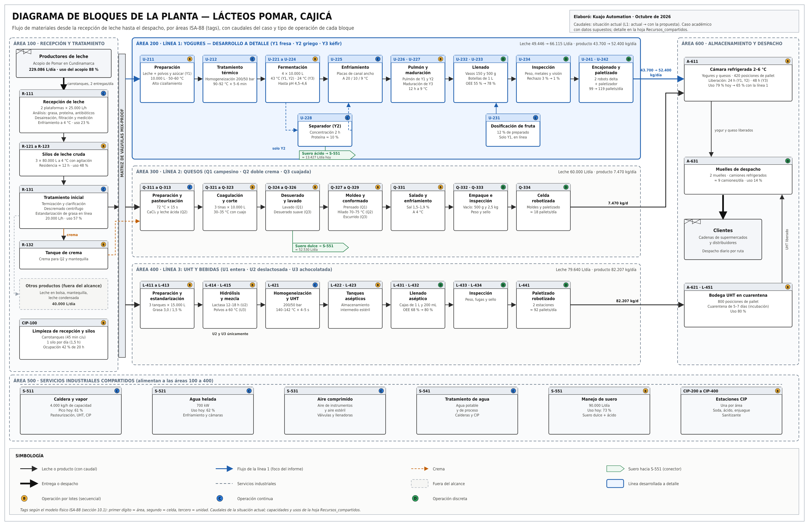
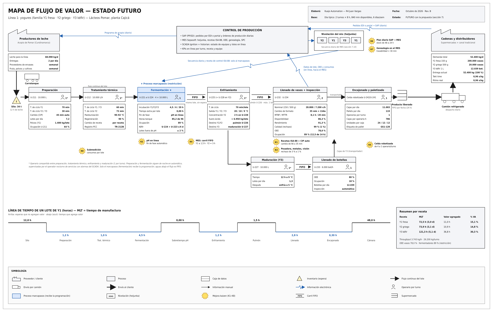
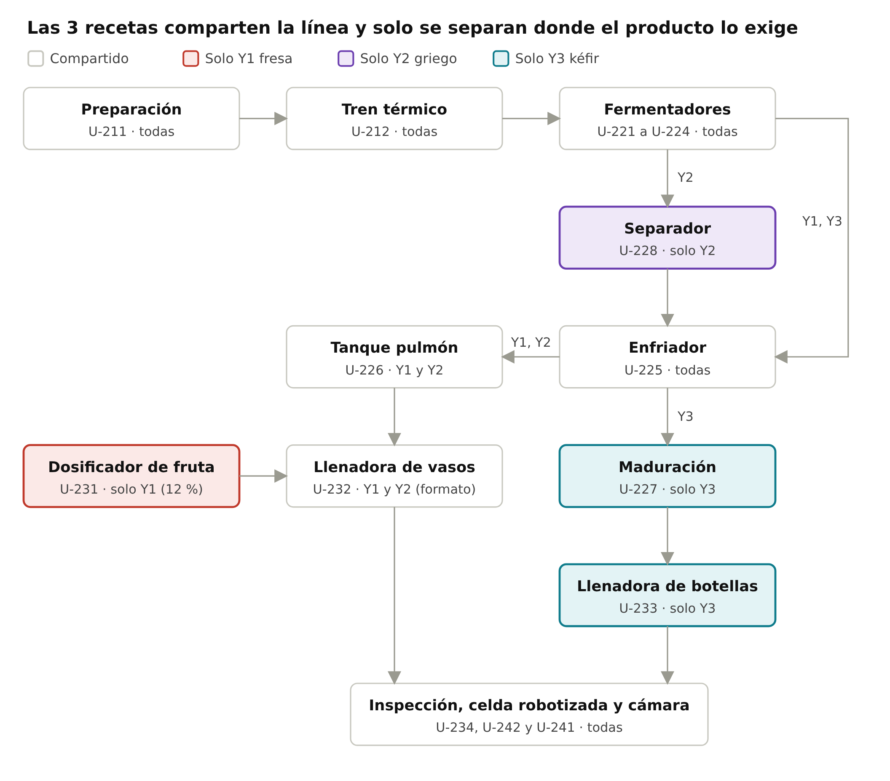
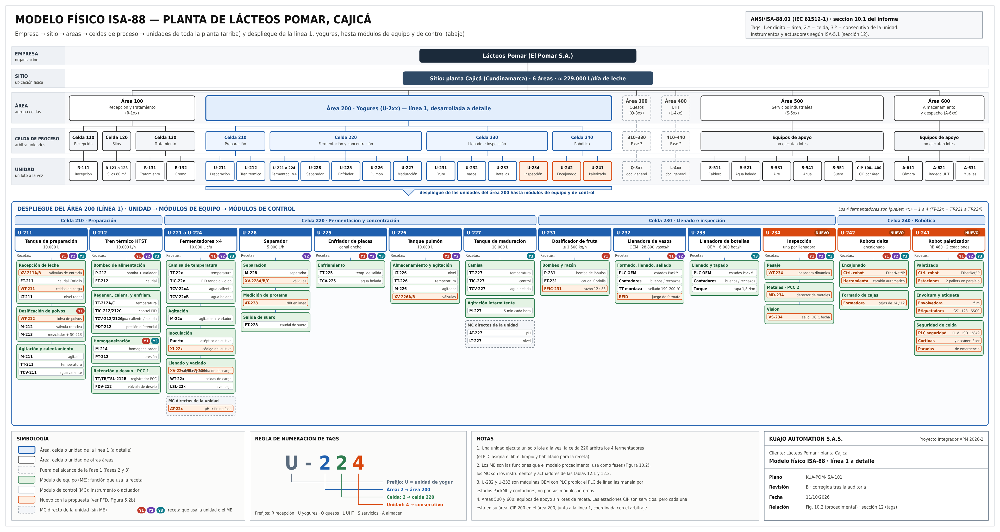
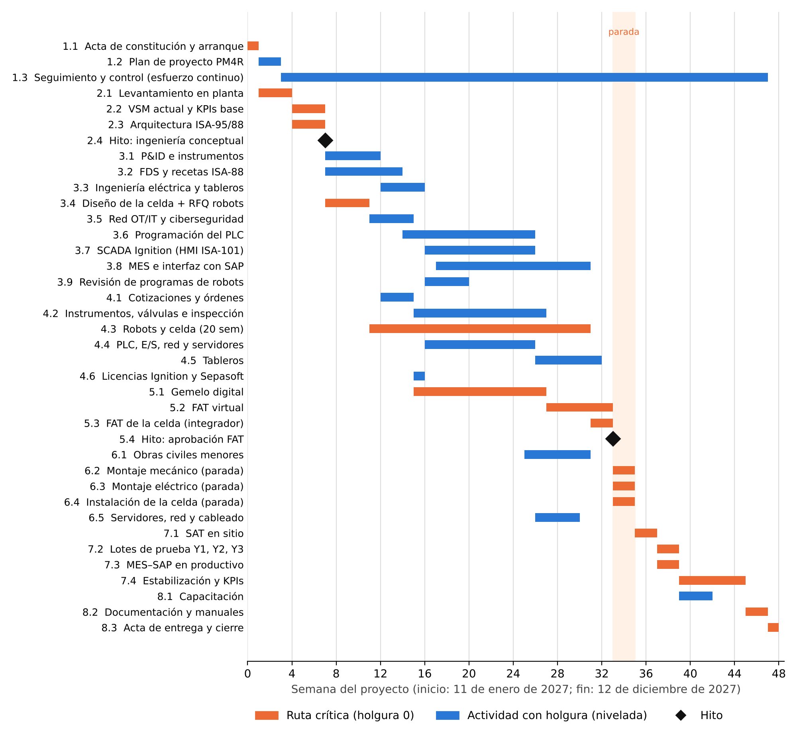
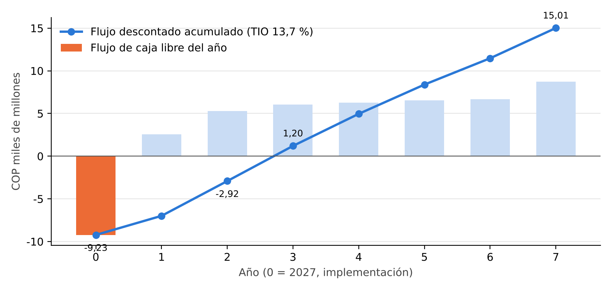

# Catálogo de figuras seleccionadas

Doce figuras permiten recorrer el contexto de planta, proceso, producción, automatización, planeación y evaluación económica. Se seleccionaron las versiones visibles del informe B; el anexo A3 conserva las doce láminas técnicas completas, incluidas las que no se repiten individualmente aquí.

Las imágenes de estado futuro expresan metas calculadas. La producción vendible y el OEE simulados se encuentran en la [síntesis](SINTESIS_PROYECTO.md#producción-calculada-y-simulación).

| Figura | Vista previa | Descripción y archivos |
|---|---|---|
| 5.1 · Bloques de la planta |  | Recepción, tratamiento, tres líneas, almacenamiento y servicios; ubica la línea de yogures en el conjunto. [PNG](figuras/png/Fig_5.1_Diagrama_bloques_planta.png) · [SVG editable](figuras/svg/Fig_5.1_Diagrama_bloques_planta.svg) |
| 5.2b · Flujo propuesto de yogures |  | Equipos, corrientes y rutas por receta; señala instrumentos, válvulas, inspección y robots que agrega Kuajo. [PNG](figuras/png/Fig_5.2b_PFD_Linea1_Propuesta.png) · [SVG editable](figuras/svg/Fig_5.2b_PFD_Linea1_Propuesta.svg) |
| 6.1 · VSM actual |  | Representa las esperas, inventarios y pérdidas actuales; la llenadora limita el cálculo base. [PNG](figuras/png/VSM_Actual_Yogures_Kuajo.png) |
| 6.2 · VSM futuro |  | Muestra nivelación del mix, programación MES y FIFO; resume las mejoras K1 a K8 y las metas calculadas. [PNG](figuras/png/VSM_Futuro_Yogures_Kuajo.png) · [SVG editable](figuras/svg/VSM_Futuro_Yogures_Kuajo.svg) |
| 7.1 · Rutas de Y1, Y2 y Y3 |  | Y1 añade fruta, Y2 concentra el yogur y Y3 requiere maduración y su propia llenadora. [PNG](figuras/png/Fig_7.1_Rutas_recetas.png) · [SVG editable](figuras/svg/Fig_7.1_Rutas_recetas.svg) |
| 10.1 · Modelo físico ISA-88 |  | Jerarquía de planta, celdas, unidades y módulos de equipo y control para ejecutar los lotes. [PNG](figuras/png/Fig_10.1_Modelo_fisico_ISA-88.png) · [SVG editable](figuras/svg/Fig_10.1_Modelo_fisico_ISA-88.svg) |
| 10.2 · Modelo procedimental ISA-88 |  | Procedimientos, operaciones y fases reutilizables con los parámetros y estados de cada receta. [PNG](figuras/png/Fig_10.2_Modelo_procedimental_ISA-88.png) · [SVG editable](figuras/svg/Fig_10.2_Modelo_procedimental_ISA-88.svg) |
| 11.1 · Integración ISA-95 |  | Relaciona campo, PLC, SCADA, MES y SAP, con decisiones descendentes, datos ascendentes y DMZ industrial. [PNG](figuras/png/Fig_11.1_Arquitectura_ISA-95.png) · [SVG editable](figuras/svg/Fig_11.1_Arquitectura_ISA-95.svg) |
| 12.1 · P&ID de yogures |  | Instrumentos, tuberías, válvulas y lazos de control; incluye pasteurización, pH y separación. [PNG](figuras/png/Fig_12.1_PID_Linea1.png) · [SVG editable](figuras/svg/Fig_12.1_PID_Linea1.svg) |
| 13.1 · Gantt de ejecución |  | Plan de 48 semanas con actividades, dependencias, hitos, ruta crítica y parada de montaje. [PNG](figuras/png/gantt.png) |
| 13.3 · Curva S |  | Valor planificado mensual y acumulado; llega al precio de la Fase 1, aproximadamente 8,53 mil millones COP. [PNG](figuras/png/curva_s.png) |
| 13.4 · Flujo de caja de Pomar |  | Flujos incrementales anuales y acumulado descontado; alcanza el VPN reportado de 15,01 mil millones COP. [PNG](figuras/png/flujo_pomar.png) |

## Láminas complementarias

El [anexo B en A3](anexos/Anexo_B_Figuras_A3.pdf) incluye además el PFD actual, el layout y la red OT/IT. El [anexo C](anexos/Anexo_C_Lineas_2_y_3.docx) contiene los diagramas de rutas de quesos y UHT. El histograma de recursos permanece en el informe completo y en el Excel.

El archivo de layout del material recibido utiliza la referencia 5.5, mientras el informe lo cita como Figura 5.3. Se conserva la numeración de las fuentes y se registra la diferencia en las observaciones.
