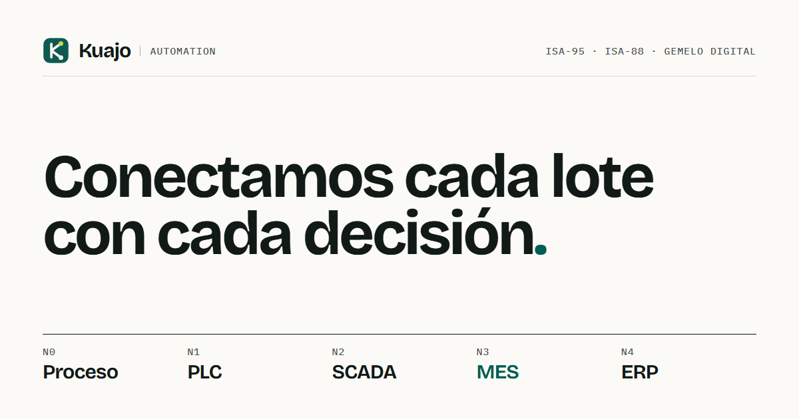

<p></p>

# Kuajo Automation · sitio web

Propuesta de transformación digital industrial (proceso → PLC → SCADA → MES → SAP, ISA-95 e ISA-88) para la línea de yogures de Lácteos Pomar en Cajicá. Proyecto integrador del curso Automatización de Procesos de Manufactura 2026-2, Universidad Nacional de Colombia. Contenido del informe versión B (11/10/2026) y de sus anexos A a D, alineado con la presentación y el guion del video de la entrega intermedia (12/10/2026).

> Caso académico. Lácteos Pomar es una empresa real usada como referencia de escala y portafolio; los problemas, indicadores y datos operativos son supuestos del curso.
>
> Las metas de proceso y las cifras financieras se presentan como **estimaciones basadas en cálculos preliminares**. Se confirmarán con la medición de la línea base y con cotizaciones.

## Tecnología

- **Astro 7** con salida estática: cada sección es un componente; el HTML sale completo y legible sin JavaScript.
- **CSS propio** sin frameworks: tokens en OKLCH, nesting nativo, `clamp()`, container queries, `:has()`, `popover`, `<dialog>`, `animation-timeline`, View Transitions y `content-visibility`.
- **GSAP + ScrollTrigger + Lenis** para el movimiento (≈ 50 kB comprimidos). Respeta `prefers-reduced-motion`.
- **Fuentes autoalojadas** (Fontsource) e imágenes en AVIF/WebP con `astro:assets`.

## Secciones (19)

| # | Código | Sección | Fuente principal |
|---|---|---|---|
| 00 | KA-INI | Inicio y planta conectada · metas estimadas | §1 |
| 01 | KA-EQU | Equipo | §2 |
| 02 | KA-CLI | Cliente y problema | §3–4 |
| 03 | KA-PRO | Planta y 3 líneas | §5, Fig. 5.1 |
| 04 | KA-ACT | Situación actual, OEE, cuello de botella y por qué la meta es alcanzable · estimaciones preliminares | §6.1–6.3, Fig. 5.2a y 5.3 |
| 05 | KA-VSM | VSM actual y futuro (pestañas) · metas preliminares | §6.2–6.7 |
| 06 | KA-PFD | Proceso propuesto y rutas por receta | §7, Fig. 5.2b y 7.1 |
| 07 | KA-REC | Recetas e ISA-88 (jerarquía desplegable) | §7.2, §10, Fig. 10.1 y 10.2 |
| 08 | KA-ARQ | Arquitectura ISA-95 y red OT/IT | §11, Fig. 11.1 y 11.2 |
| 09 | KA-INS | Instrumentación, P&ID y tabla filtrable de 86 tags | §12, Fig. 12.1, hoja Instrumentos |
| 10 | KA-SIM | Simulación de eventos discretos · estimación preliminar | §6.9, hoja Simulacion, Resumen_Estimaciones_Kuajo.xlsx |
| 11 | KA-RES | Resultados por módulo: 8 módulos con dos responsables cada uno | Presentación |
| 12 | KA-PM4R | EDT, Gantt, histograma, curva S, presupuesto, riesgos, RACI, comunicaciones y adquisiciones · cifras preliminares | §13, anexo A |
| 13 | KA-EVA | Indicadores de Pomar, crédito rotativo y detalle plegable (sensibilidad, PyG y flujo mensual de Kuajo) · cifras preliminares | §13.9–13.11, Resumen_Estimaciones_Kuajo.xlsx |
| 14 | KA-OFE | Oferta comercial KA-OF-2026-001 · precio estimado | §14 |
| 15 | KA-LIN | Líneas 2 y 3 y planta completa · referencia preliminar ±30 % | §8–9, anexo C |
| 16 | KA-CON | Conclusiones · cálculos preliminares | Guion del video |
| 17 | KA-APR | Trabajo en equipo: forma de trabajo, hitos y compromisos | §15, guion del video |
| 18 | KA-DES | Descargas y 44 fuentes | Anexos |

## Estructura

```
public/descargas/              (generada) informe, Excel, anexos, sim.py y figuras vectoriales
scripts/copy-assets.mjs        Copia esos archivos desde las carpetas de módulos del repositorio
scripts/sync-excel.mjs         Excel → src/data/excel.json (npm run sync)
scripts/check-data.mjs         Compara las cifras de site.ts con el Excel (npm run check)
scripts/og.mjs, og.html        Genera og-image.png con Chrome sin interfaz
src/data/site.ts               Textos y cifras escritas a mano (todas verificadas por check)
src/data/excel.json            Series del Excel: Gantt, histograma, flujos, matrices, 86 tags…
src/data/figuras.ts            Registro de figuras con su texto alternativo y pie
src/assets/figuras/            (generada) PNG de las figuras; Astro genera AVIF/WebP
src/assets/equipo/             Fotos del equipo 960 × 1200 (Astro genera AVIF/WebP)
src/lib/fmt.ts                 Formato numérico es-CO y aprox() para cifras preliminares
src/styles/                    tokens.css, global.css, components.css
src/components/                Una sección por archivo, Figura (visor), Preliminar (etiqueta), Nav, Footer
src/scripts/motion.ts          Lenis, trazado SVG, contadores, barras, ISA-95, pestañas, filtro, visor
docs/BRAND.md, docs/marca/     Manual de marca, íconos y plantillas
```

## Datos: de dónde sale cada cifra

La página no guarda copias propias del informe, el Excel ni las figuras: los toma de las carpetas de módulos del repositorio (`informes/`, `01_proceso/` … `05_pm4r/`). Antes de `npm run dev` y `npm run build` se ejecutan solos:

1. `scripts/copy-assets.mjs`: copia informe, anexos, los dos Excel (libro completo y resumen de estimaciones), `sim.py` y figuras a `public/descargas/` y `src/assets/figuras/` (carpetas ignoradas por git).
2. `scripts/sync-excel.mjs`: regenera `src/data/excel.json` desde `05_pm4r/Planeacion_PM4R_Kuajo_Pomar.xlsx`.

- **Textos y cifras sueltas** (KPIs, economía, oferta, conclusiones): `src/data/site.ts`. Ningún componente lleva cifras escritas a mano.
- **Estimaciones preliminares:** los valores exactos viven en `site.ts` (`economics`, `lines23`, `teamHours`) y en el Excel, y `npm run check` los compara. Lo que se muestra se redondea, con `aprox()` de `src/lib/fmt.ts` (por ejemplo, «≈ $15.000 M») o con textos ya redondeados en `site.ts`. Las secciones con metas o cifras futuras llevan la etiqueta `Preliminar`, que abre la nota `site.preliminar`. Los valores de hoy (línea base supuesta) se dejan exactos.
- **Series y matrices** (cronograma, histograma, curva S, flujos, sensibilidad, EDT, riesgos, RACI, instrumentos, simulación): `src/data/excel.json`.
- Si cambia el Excel o una figura: reemplázalo en su carpeta de módulo y haz `push`. Si una cifra de `site.ts` deja de coincidir, `npm run check` lo dice (y la publicación se detiene).

`npm run check` compara 50 cifras de `site.ts` con el Excel (precio, VPN, TIR, recuperación, B/C, OPEX, horas por integrante, 48 semanas, simulación, líneas 2 y 3) y busca textos obsoletos en `src/`, incluidas las reglas de trabajo anteriores («con acta», «GitHub Projects», «61 hallazgos»…). Sale con error si algo difiere.

## Pendientes

Se muestran como `[PENDIENTE]` en el sitio:

- `site.video` en `src/data/site.ts`: enlace de YouTube. Mientras tanto, la página dice «Video en edición (25 a 30 min)».
- Reflexiones grupal e individuales: variables `group` e `individual` en `src/components/Aprendizaje.astro` (el informe no las incluye).

## En local

Requiere Node.js 22.6 o superior.

```bash
npm install
npm run dev        # http://localhost:4321  (?nolenis desactiva Lenis para pruebas)
npm run build      # genera dist/
npm run preview    # sirve dist/
npm run sync       # Excel → src/data/excel.json
npm run check      # verifica cifras contra el Excel y textos obsoletos
npm run typecheck  # revisión de tipos (astro check)
npm run og         # regenera public/og-image.png (necesita Chrome)
```

## Publicar en GitHub Pages

La página se publica desde el repositorio de todo el proyecto con el flujo `.github/workflows/deploy-pagina.yml` (en la raíz del repositorio). Cada `push` a `main` la vuelve a compilar y publicar en `https://<usuario>.github.io/<repositorio>/`. Los pasos están en el README de la raíz.

El flujo fija `SITE` y `BASE_PATH` a partir del usuario y el nombre del repositorio. Si el repositorio se llama `<usuario>.github.io`, cambia `BASE_PATH` a `/`.

## Verificación (12 oct. 2026, compilación de producción con `npm run preview`)

| Prueba | Resultado |
|---|---|
| `npm run check` | 50 cifras coinciden con el Excel; sin textos obsoletos |
| `npm run typecheck` y `npm run build` | Sin errores ni advertencias |
| Cifras exactas en texto visible | Fuera del detalle plegado, VPN, TIR, precio y metas aparecen redondeados con «≈» |
| 360, 768 y 1280 px | Sin desplazamiento horizontal, con todos los plegables abiertos |
| Modo claro y oscuro | Etiqueta preliminar legible: ámbar #8A5300 sobre crema #EFE6CF (5,1:1) en claro; ámbar claro sobre marrón oscuro en oscuro |
| Teclado | El detalle de Evaluación se abre con Enter; la etiqueta abre la nota (popover) y Esc la cierra |
| Animaciones | Los contadores terminan en «≈ $15.000 M», «≈ 49 %», «≈ 2,2 años» y «≈ 2,6»; barras y trazado completos dentro del plegable |
| Sin JavaScript y movimiento reducido | El HTML ya trae los valores finales; con `prefers-reduced-motion` no se cargan Lenis ni las animaciones (`motion.ts`) |

Lighthouse no se volvió a correr en esta revisión.
